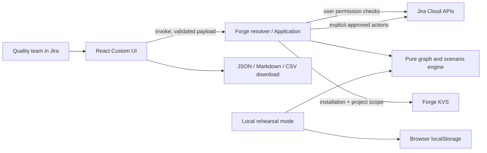
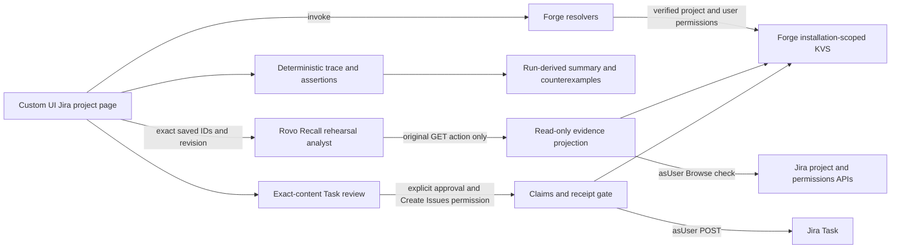

# LotZero architecture

Status describes the source design; live Forge/Jira behavior requires the receipts in `FINAL_EVIDENCE.md`. The system is deliberately a single Forge application with a pure deterministic engine. No external database or AI service is required.

## Data flow and ownership

The browser owns temporary screen selection, graph inspection and hypothetical control forms. The server owns project authorization, persistent datasets/snapshots, action derivation, approval receipts and Jira writes. Persisted results are recomputed from the server's stored dataset; the browser cannot submit an arbitrary issue body or authoritative trace. Imports are untrusted data even after structural validation.

`src/index.ts` maps Forge resolver names to `Application`. `src/storage/port.ts` and `src/integrations/port.ts` isolate persistence/Jira adapters for controlled tests. `src/graph/engine.ts` exports pure entry points shared by the UI and resolver. Local rehearsal deliberately uses browser persistence and disables Jira creation; it is not a Forge emulator or live integration proof.

## Contracts and provenance

`src/contracts.ts` defines:

- `Dataset`: version, name, synthetic flag, typed nodes, directed relationships and documentary references.
- `RecordNode`: supplier, ingredient, batch, product, transformation, warehouse, shipment or destination; optional quantities, ownership and timestamps remain explicitly optional.
- `RecordEdge`: supplies/consumes/produces/repackages/stores/ships/delivers, source/target IDs, evidence IDs and confirmed/potential/unknown certainty.
- `Scenario`: ingredient source, hazard, explicit scenario clock and selected assertion IDs.
- `DrillResult`: evidence paths, findings, assertions, reachable product/shipment IDs, unresolved records, compatible quantity totals and simulated movements.
- `Snapshot`: full input dataset, result, capture time and initiator; Jira receipts are hydrated separately.

`src/schemas/dataset.ts` enforces runtime shapes. Limits: 200,000 UTF-8 input bytes, 1,000 nodes, 3,000 edges, 3,000 documentary entries, 30 references per record, 500 characters per descriptive field. A saved snapshot also has a 230,000-byte ceiling. CSV uses the explicit `record_type,json` envelope described in `fixtures/README.md`; arbitrary ERP-column inference is not supported.

## Deterministic evaluation

The engine takes its clock from the scenario and performs no network requests, randomness or external reads. Graph building detects duplicate/conflicting records, invalid relationships, dangling references and cycles. Bounded traversal follows material relationships; sharing a warehouse does not imply ingredient exposure. Both forward and backward paths retain record/evidence IDs.

Known source association and full genealogy completeness are separate questions. One confirmed path can establish an association while another ancestor branch remains unknown. Every material ancestor branch must terminate in an evidenced ingredient; an orphan batch/transformation/product is not a complete origin. Ambiguous identities supporting an assertion remain UNKNOWN. Disconnected records with incomplete origins remain unresolved; absence from the chosen trace is never proof of safety.

Shipment totals deduplicate by shipment identity. Mass normalizes to kg; volume to l; item counts remain units. A total is full recorded shipment quantity, not contaminated ingredient mass. Missing quantities are reported as gaps. No dose, yield, package conversion or mass-balance inference is made.

Assertions return PASS, FAIL or UNKNOWN with applicable-record counts and counterexamples. No applicable quarantine is UNKNOWN, not vacuously passed. Dataset fingerprints are FNV-1a identification checksums, not security signatures. Legacy UUIDs and request-scoped SHA-256 save identifiers identify snapshots; SHA-256-derived markers identify Jira actions. Comparisons require matching source, hazard, scenario time and assertion set; FAIL↔UNKNOWN alone is not an improvement.

## Simulation invariants

Historical shipments remain in every report. Controls cannot predate the scenario clock. A quarantine changes only eligible future movement supported by a unique evidenced stock link, unambiguous and evidenced shipment/product/warehouse records, and compatible sufficient recorded quantity. Whole shipments consume the stock budget in stable scheduled order; earlier movements are considered. Unknown quantities invalidate unsupported prevention claims. A direct hold is hypothetical and does not prove physical stock availability. Investigation and owner assignment are proposals, not silent repairs or Jira assignee changes.

The stock relationship is assumed to record stock remaining at scenario time. LotZero does not independently reconcile warehouse inventory. This assumption must be disclosed when importing records.

## Authorization and persistence

Forge provides installation-level KVS isolation; application keys add `p:<verified Jira project ID>:`. The project is resolved through Jira using resolver context. Browse permission is checked before access; project administration is required for dataset loading/import/deletion. Jira creation also requires Browse and Create Issues in the selected target project. Calls use `asUser()` and escaped `route` templates.

| Key family | Purpose | Retention |
|---|---|---|
| `dataset` | Current validated dataset | Until overwritten or explicit reset |
| `snapshot:<uuid>` | Reproducible run | 90-day TTL |
| `audit:<time>:<uuid>` | Actor, time, event | 90-day TTL |
| `claim:<snapshot>:<action>` | Durable action reservation | Until explicit reset; no automatic expiry |
| `receipt:<snapshot>:<action>` | Outcome, issue reference, supporting action content | Until explicit reset |
| `mutation-lock` | Serialize mutations within a project | Removed in normal `finally`; may survive a hard invocation termination |

TTL deletion is asynchronous at the provider; see `PRIVACY.md`. No cross-installation keys or user-supplied tenant IDs are accepted.

## Jira transaction boundary

The application accepts saved snapshot/action IDs, target project/type and `approved: true`, with a maximum of five selected actions. Suggestions are reconstructed from the saved findings. A durable action claim and uncertain receipt are written before calling Jira. A confirmed issue key produces a created receipt. A definite rejection permits an explicit retry. An interrupted/ambiguous POST is not automatically repeated. This avoids silently duplicating a task when Jira accepted a request but its response was lost; it is not an exactly-once distributed transaction.

A project mutation lock prevents reset and issue creation from interleaving. The lock is intentionally not automatically expired during a potentially active Jira call. Hard termination recovery is an operational limitation requiring deliberate review. Implemented administrator reconciliation attaches only a Jira issue whose stored marker matches; it must never infer non-creation from an empty search. See `INSTALLATION.md` and the final release evidence for implementation/verification status.

## Deployment and change management

A Vite production build uses Forge bridge transport. `npm run dev` uses explicitly labeled rehearsal transport. Do not deploy the rehearsal build as a Forge release. Judge and Marketplace editions use separate real registered app IDs and the same tested code; only configuration identity differs. No source migration is required for v0.1. Future contract changes need versioned readers and export/recovery plans before rewriting stored snapshots.

Limits intentionally favor inspectable hackathon datasets over ERP-scale graphs. Saved histories, Jira pagination and per-request action count are bounded. Performance results are local synthetic measurements in `BENCHMARKS.md`, not production capacity guarantees.

The manifest allows inline styles for validated graph coordinates. It does not allow unsafe inline scripts or eval. Dataset save checks a content fingerprint against reviewed input. A reset-in-progress tombstone blocks new writes after interrupted deletion until an administrator resumes the confirmed reset.

## Judge candidate: read, explain, approve — local 15 November

No new storage schema or migration is introduced. The summary and timing limit are projections; the saved `DrillResult` and revision inputs remain unchanged. The sanitized historical export reproduces exactly in local tests. The Rovo summary adds bounded follow-up references and explicit timing UNKNOWN; it cannot approve or write. `--judge-release` selects the candidate prompt and registers only the Jira page/resolver and original agent/action/function, leaving optional development work in the source tree without registering those modules.

The Forge candidate declares no third-party external egress permissions. Jira, Forge storage and optional Rovo still process data within Atlassian services; absence of external permissions does not mean no personal-data processing or zero network use. The browser preview is a separate localStorage transport. See [the changed API contracts](JUDGED_RELEASE_API_CONTRACTS.md), [release comparison](JUDGED_RELEASE_DIFF.md) and [security boundaries](SECURITY.md).
