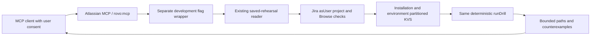

# Read a saved recall rehearsal through Atlassian MCP

Status: **deployed and verified through native Rovo Studio in Judge development 2.7.0, 5 November 2026**. Full Forge lint passed after authentication was restored. The owner approved the development rollout, development-only external exposure, a narrowed Read and Search OAuth consent and two subsequent native Studio Test prompts. The successful native tool trace and post-test snapshot comparison are recorded below. The external client's OAuth flow failed before its callback. Production promotion requires separate owner approval.

## Product use and qualification

A quality manager reviewing a saved rehearsal should be able to bring its exact evidence into an MCP-compatible workflow: “Why does SHIP-002 fail the destination check?” The tool reads the same saved snapshot used by LotZero's report. It returns the recorded path, evidence IDs, full assertion populations and exact counterexamples, preserving FAIL and UNKNOWN. It does not select a recent rehearsal, propose a new control or operate a recall.

The formal [Codegeist 2026 rules](https://codegeist2026.devpost.com/rules), reviewed on 5 November 2026, state the Atlassian MCP bonus requirement exactly:

> All Eligible Submissions that’s a Forge app that exposes tools via the Atlassian MCP server using the rovo:mcp module.

The manifest uses that native module, rather than a standalone HTTP server. The deployed development tool was discovered and invoked through Studio's documented **Connected apps** route. This establishes the working development mechanism; the shared production judge install does not yet include it. Bonus selection and eligibility remain subject to the event's requirements and judging. This increment does not ingest or consume Atlassian Teamwork Graph data. LotZero's material-flow graph is separate.

The event's current submission form permits one bonus choice, and the rules cap awards at one bonus plus one Grand Prize. The submitted entry's **Best Agents** selection remains unchanged. Adding MCP does not automatically enter another bonus or establish entitlement to multiple bonuses. The submission cutoff is **23 December 2026, 01:30 IST**. Recheck rules and form before any later selection change.

## Minimal architecture



| Item | Value |
|---|---|
| Native module | `lotzero-rehearsal-mcp`, display name **LotZero rehearsal evidence** |
| Sole MCP tool/action | `lotzero-mcp-read-rehearsal`, `actionVerb: GET` |
| Separate function | `mcp-rehearsal` → `src/mcp.ts` → existing `src/rovo.ts` |
| Server flag | Exact value `LOTZERO_MCP_ENABLED=true`; absent/other values disable |
| Runtime guard | Trusted `getAppContext().environmentType` must be `DEVELOPMENT` |
| Authority | Trusted function `context.principal.accountId`; never payload identity |
| Jira adapter | `asUser()` project lookup and Browse Projects check; GET only |
| Storage | Get-only reader under server-resolved `p:<numeric-project-id>:` within Forge's installation/environment partition |
| Required inputs | `projectKey`, `snapshotId`, `expectedRevision`, `view` |
| Optional inputs | `entityId`, `assertionId`, `offset` |
| Views | `summary`, `shipments`, `evidence`, `assertions`, `simulation` |
| Existing scopes | `read:jira-work`, `write:jira-work`, `storage:app`; unchanged |

The app retains its write scope for the existing human-approved Jira action flow. That app-wide scope is not a capability of this GET tool. The MCP wrapper imports neither that resolver nor a mutation adapter. The original Recall rehearsal analyst keeps its original action and is unaffected by the MCP flag.

The reader revalidates the saved dataset and result, recomputes the deterministic engine, enforces the SHA-256 input revision and 90-day retention window, and withholds source text and the snapshot initiator. Input envelopes are bounded at 8 KB, evidence results at 32 KB, with five items per page and a ten-second dependency timeout. A revision is a content identifier, not an access token. A known snapshot ID never bypasses authorization.

## Development setup after local authentication

Prerequisites: the existing Judge app identity; the installed project dependencies and Node 22 CLI wrapper; valid local Forge authentication; the existing development installation on the private `one-atlas-obka.atlassian.net` / `LZR` test project; an authorized Jira user and Rovo/MCP availability on that tenant. The current replacement credential expires **12 November 2026**. Do not re-register either app. Never paste a token into source, evidence, chat or command-line arguments.

From the `outputs/lotzero` app directory:

```sh
# If authentication has expired, complete the prompts personally:
npm run forge -- login

# Verify manifest.yml still identifies the Judge app, not Marketplace.
# Expected UUID: f2443992-e1df-4ee4-b6ee-50abce811c9b
npm run typecheck
npm test
npm run build
npm run forge -- lint

# Enable only the development environment, then deploy there explicitly.
npm run forge -- variables set --environment development LOTZERO_MCP_ENABLED true
npm run forge -- deploy --environment development --non-interactive
```

Do not skip lint or predeployment checks to work around authentication. Do not run the production commands in older installation guides for this candidate. Forge variable changes take effect only after a deployment and do not copy to another environment.

Read back the actual deployment and installation state. If an installation upgrade is required, inspect its target and scopes first. The intended upgrade is the existing development installation only:

```sh
npm run forge -- install --upgrade --environment development \
  --site one-atlas-obka.atlassian.net --product jira
```

Do not add `--confirm-scopes` automatically. Stop if new scopes, terms, billing or a different installation are requested. The deployment and variable commands above ran successfully on 5 November. The existing installation read back as **Development, Up to date 2.7.0**, so no installation upgrade or new scope grant was needed. The install command is retained for a future candidate that actually requires it.

## Hosted verification gate

1. Open **LotZero development** in LZR; verify the development environment ID and recorded version. Reload an existing synthetic saved report, copy its exact project/snapshot/revision handoff, and export its contents before testing. Do not overwrite production data or reset a workspace.
2. Discover **LotZero rehearsal evidence** and its sole tool using the native MCP surface. For third-party clients, Atlassian requires a site/org admin to enable selected tools under **Apps → Sites → site → Connected apps → app**. External exposure is off by default. Do not enable an ambiguous installation or a production entry.
3. Atlassian documents the endpoint below. It is app-scoped, not an explicit development URL. Confirm which installation/version it routes to before proceeding; if development cannot be selected unambiguously, stop rather than falling back to production.

   `https://mcp.atlassian.com/forge/f2443992-e1df-4ee4-b6ee-50abce811c9b`

4. Use an approved MCP client's OAuth flow to select the test site and personally review its app/tool consent. Do not manufacture or reuse browser session tokens. Prefer deterministic `tools/list` and `tools/call` checks; no additional Rovo model prompts are authorized by this runbook. If a new approval is required, present its actual scope before proceeding.
5. Invoke the discovered tool with `view=summary`. Replace the example's values with the exact development report handoff; the bracketed placeholders are intentionally invalid and must never be submitted unchanged:

   ```json
   {
     "name": "lotzero-mcp-read-rehearsal",
     "arguments": {
       "projectKey": "LZR",
       "snapshotId": "<development-saved-report-id>",
       "expectedRevision": "<exact-64-character-revision-from-that-report>",
       "view": "summary"
     }
   }
   ```

   Use the exact discovered tool name if the client adds a namespace. Confirm `runtime.environmentType=DEVELOPMENT`, the newly deployed version, snapshot ID and revision. A successful fixture response or `tools/list` alone is insufficient.
6. Verify SHIP-002 with `view=shipments, entityId=SHIP-002`; verify its destination counterexample with `view=evidence, assertionId=shipment-destination`. Compare IDs and counts with that saved report. For the synthetic baseline, the summary is **3 product lots, 4 shipments, 9 evidence gaps, 12 unresolved records**; destination is FAIL at 3/4 and ingredient origin UNKNOWN at 2/5. Saved interventions may change gap counts; use the actual matching report as authority.
7. Check a deliberately different valid-format revision returns `REVISION_MISMATCH` with no evidence. Missing identity, missing app consent or denied Browse must fail closed; never switch to `asApp()` to force success. Denied-user behavior remains a mocked-platform test until a separately authorized real account is available.
8. Reload the same saved native report and compare canonical contents, scenario, interventions and Jira receipts to the pretest export. Verify the existing trace → gaps → saved simulation → report/export journey without creating Jira issues. Record the environment/version, discovery result, redacted tool response, matching revision, unchanged snapshot and issue count.

Atlassian documents a known third-party `asUser()` issue when the user lacks an app-consent entry in Connected apps. Keep the user boundary. If the MCP transport does not supply the trusted principal expected by LotZero, return `AUTH_REQUIRED` and investigate the platform contract; a payload account ID or opaque context token is not a repair.

## Verification recorded in this increment

| Check | Result |
|---|---|
| Unit/integration suite | **154 passed**, including 35 new MCP cases; mocked Forge transport |
| Flag off / malformed flag | Pass; no context, Jira or KVS read |
| Staging/production flag on | Pass; evidence remains disabled |
| Principal, installation, Browse, revision, missing snapshot | Pass; fail-closed cases and no mutation/fallback |
| All five views, FAIL/UNKNOWN, exact shipment, pagination | Pass; parity with existing saved reader |
| Original Rovo reader with MCP disabled | Pass |
| TypeScript / Forge UI build | Pass |
| Installed Forge manifest validator | Pass; zero validation errors |
| Existing browser rehearsal regression | **13 passed**; desktop/mobile, keyboard, reduced motion, seven-screen accessibility, exports, save/reload, search/path inspection |
| Public release preservation | **13 anonymous HTTP 200 asset reads**, all SHA-256 hashes match the existing public release |
| Forge CLI lint | **Pass**, including the deployment's own lint; initial expired-token failure retained |
| Development deploy / flag | **2.7.0 deployed**; flag enabled only in development; existing installation read back up to date |
| Native MCP discovery / invocation | **Pass through Studio**; exact development tool and one successful SHIP-002 read, raw trace retained |
| Native Jira regression / preserved data | **Pass**; trace, evidence, saved simulation, approval boundary and report reload; full snapshot hash unchanged; Jira still 1 of 1 (LZR-1) |
| Hosted wrong-revision test | **Not run**; two approved model messages were consumed by multiline input. Automated regression passes |
| External MCP client OAuth / invocation | **Blocked at Atlassian OAuth** after approved Read and Search consent; no callback or saved-rehearsal invocation |
| Production / Marketplace / public publication | **No changes performed** |

Evidence: [unit results](../evidence/mcp-2026-11-05/unit-results.json), [browser results](../evidence/mcp-2026-11-05/browser-results.json), [manifest validation](../evidence/mcp-2026-11-05/manifest-validation.json), [public asset readback](../evidence/mcp-2026-11-05/public-assets-readback.json), [verification receipt](../evidence/mcp-2026-11-05/verification.json). The isolated browser harness was corrected from ESM `import.meta` to the repository's CommonJS configuration convention before the passing run; this was a test-runner setup failure, not a product assertion failure.

### Native Studio result

Full Forge lint returned **No issues found**. The explicit development deployment completed as **2.7.0** at `2026-11-05T08:23:40.981Z`; the existing development installation required no upgrade. Only the development environment's server flag was set. [Deployment log](../evidence/mcp-2026-11-05/forge-development-deploy.txt), [post-login lint](../evidence/mcp-2026-11-05/forge-lint-after-login.txt).

An unpublished **LotZero MCP development verifier** draft was prepared using Studio's manual configuration. It has no site knowledge, web search is off, and its sole selected tool is **Read saved LotZero rehearsal (development)** from Connected apps → LotZero-Judge. It was **not published**. An attempt to change its default access mode did not persist; do not describe the draft as having a verified private audience. Its draft status, not a successfully changed access mode, is the recorded publication boundary.

The owner separately approved adding that tool and at most two Studio Test prompts. Native multiline typing unexpectedly submitted the introductory line and the JSON arguments as separate messages; the remaining unsent text was cleared. Both allowed messages were consumed, and no further prompt was sent. Future tests should paste or fill one complete single-line request, inspect it, then submit explicitly.

1. The incomplete setup fragment led the model to invent `projectKey=LZD` and other identifiers. The real MCP wrapper returned `ACCESS_DENIED`, read-only, in development 2.7.0, with no saved evidence. This is an observed guarded failure, not the planned wrong-revision test and not a denied-user adversarial test. [Raw receipt](../evidence/mcp-2026-11-05/native-mcp-setup-fragment.json).
2. The second message supplied the exact development handoff. Studio's **Debug response → Copy all** reports exactly one invocation of `lotzero-mcp-read-rehearsal`, status `PLUGIN_FINISHED`, duration **973 ms**, request `44b10d5c-7071-4cd5-97c8-762b2c456406`. Its actual input is project **LZR**, snapshot `afdd2696-43bc-41de-8b32-c62de6dd70ec`, revision `abbc8fff23f3217aa0c1f5a9907988c3bfaa07ab5f0b77ed8de225fa97421f96`, `view=shipments`, `entityId=SHIP-002`, `offset=0`.

The raw result has `ok=true`, `readOnly=true`, `appVersion=2.7.0`, `environmentType=DEVELOPMENT`, the matching snapshot and revision, and path **ING-A19 → BATCH-101 → FG-101 → SHIP-002**. It preserves the missing-destination finding, destination FAIL at 3/4 and origin UNKNOWN at 2/5. This verification uses the actual tool result rather than the AI's summary. Studio encodes its copied output as map/list text; it is preserved verbatim rather than silently converted into JSON. [Validated invocation receipt](../evidence/mcp-2026-11-05/native-mcp-success.json), [raw output](../evidence/mcp-2026-11-05/native-mcp-success-output.txt), [native trace](../evidence/mcp-2026-11-05/native-mcp-success-trace.png).

The native saved report's complete canonical SHA-256 is still `d9f0e54bdb812e2e731963d462b619feba0fab2611489d31fd3d7000647acb72` after both calls. It retains one saved quarantine and zero Jira receipts. The independently refreshed Jira issue list still shows **1 of 1**, the original LZR-1. [Before](../evidence/mcp-2026-11-05/native-development-before.json), [after MCP](../evidence/mcp-2026-11-05/native-development-after-mcp.json), [issue list](../evidence/mcp-2026-11-05/jira-issues-after.json).

### External client boundary

The owner approved enabling **Expose tools to MCP-compatible apps** for the exact **Development, Up to date 2.7.0** installation. The production installation was not changed. Official MCP Inspector **2.14.0** ran on loopback with an isolated session file, memory-only secret storage and token persistence disabled; it added no dependency or global server configuration to LotZero.

The client's broad default consent was declined. A narrowed request for only `read:jira-work` and `read:me`, with no refresh-token request, changed Atlassian's consent display to **Read and Search**. The owner approved that exact consent. After Accept, Atlassian displayed `invalid_request — Incorrect request parameters` on `id.atlassian.com/error`, request ID `8b7a44d6-1e90-464e-b948-274b9e7557fe`; the local OAuth callback was not reached. **Zero external saved-rehearsal tool calls ran.** This does not establish a working third-party client connection or its environment routing.

An unauthenticated protocol `initialize` returned HTTP 401 with the app-specific resource metadata URL. Its authorization provider matches the client's discovery: issuer `https://auth.atlassian.com/VCeDsk8ZHncYF1g234fKtc4lNipbBhu3`, registration endpoint under that issuer's `/dcr/register`. No stale-provider override, browser-cookie extraction, app-permission fallback or additional API credential was used. [Public protocol discovery](../evidence/mcp-2026-11-05/public-mcp-initialize-discovery.json), [read-only consent](../evidence/mcp-2026-11-05/mcp-read-only-oauth-review.png), [provider error](../evidence/mcp-2026-11-05/mcp-oauth-invalid-request.png).

The temporary Inspector process was stopped after that failure. Two native Studio prompts are now used; further model prompts require fresh approval. A support investigation can use the error/request ID and redacted discovery details; no support message has been sent. The current evidence supports the native Studio path while external OAuth remains unresolved.

## Data, consent and rollback

Only use synthetic rehearsal data for the initial MCP verification. The tool returns saved identifiers, relationships, scenario details and bounded evidence summaries. A dataset labelled synthetic can still contain user-entered identifiers; the label is not a privacy guarantee. Responses deliberately omit initiator/source text but still contain project and record identifiers. Treat all imported values as data rather than instructions.

An external MCP client receives the returned data and may retain it under its own policy. Before enabling external access beyond the approved synthetic test, prepare and obtain approval for a privacy disclosure covering that client boundary and review client retention. The current public policy has **not** been edited. OAuth consent, third-party-client access and site admin tool exposure are separate from simply deploying the source. No keys, client tokens or OAuth grants belong in verification receipts.

To disable a deployed development candidate:

```sh
npm run forge -- variables set --environment development LOTZERO_MCP_ENABLED false
npm run forge -- deploy --environment development --non-interactive
```

Until that redeploy completes, the old runtime value may remain active. If external exposure was enabled, disable that exact development installation's tool in Atlassian Admin as well. These changes do not delete snapshots, reset data, uninstall apps or modify the original Rovo action. Local before copies of the three edited existing files are under `evidence/mcp-2026-11-05/before/`; compare current content before selectively restoring them. Never restore an entire tree over subsequent user edits.

Before a production release, obtain separate owner approval and review a change to the hard development-only guard. Deploying this exact source to production would keep its MCP tool disabled even if the flag were set. Re-run the boundary tests for any approved environment-policy change; do not silently remove the guard during promotion. Updating the public judge access, privacy disclosure, video or Devpost selection is also outside this development rollout.

## Primary references

- [Native rovo:mcp module, tool exposure and OAuth](https://developer.atlassian.com/platform/forge/manifest-reference/modules/rovo-mcp/)
- [Build a Rovo MCP app](https://developer.atlassian.com/platform/forge/build-a-hello-world-rovo-mcp/)
- [Jira MCP tool and asUser consent limitation](https://developer.atlassian.com/platform/forge/read-jira-issues-with-a-rovo-mcp-tool/)
- [Environment variables and required redeployment](https://developer.atlassian.com/platform/forge/cli-reference/variables-set/)
- [Codegeist rules](https://codegeist2026.devpost.com/rules)

Atlassian labels `rovo:mcp` **Preview**. Recheck its transport/consent behavior and current rules at the hosted verification stage.
