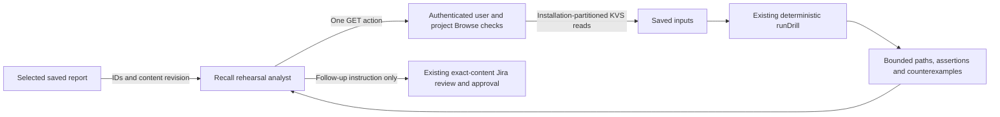

# Recall rehearsal analyst — verification candidate

Verified on 30 October 2026 in **judge production 2.5.0**, development 2.6.0 and staging 2.4.0. After specific owner approval, the exact tested source was promoted to production. Two native production Rovo questions and raw tool outputs matched the original saved rehearsal. Its full saved content, scenario, interventions and original LZR-1 receipt remained unchanged. Marketplace production was not deployed. The revised privacy policy and the new [2:53 Jira + Rovo demo](https://youtu.be/KNKdnH8N6kw) are public. Native playback and manual English captions are verified. After the user explicitly requested the entry update, its product story, new video, testing/technology/AI-use answers and Best Agents selection were saved and verified; [receipt](../evidence/devpost-rovo-update-2026-10-31/receipt.json).

## Purpose and boundary

A quality manager opens a saved Drill report and asks which shipments are associated with its source ingredient, where evidence is missing, why an assertion fails or remains unknown, or what its saved intervention changes. The action recomputes `runDrill` from that snapshot's authoritative dataset, scenario and interventions. It does not interpret a separate graph, select the latest snapshot, construct a new quarantine or mutate a scenario.

The handoff carries a project key, saved snapshot ID and SHA-256 revision of its immutable inputs. This is a content identifier, not an authorization token or digital signature. The existing short dataset fingerprint is retained for comparison and is not used as proof of freshness. A changed live dataset is explicitly distinguished from a historical saved snapshot.



The analyst has no action for creating Jira issues, changing app data, contacting anyone or operating a warehouse. The ordinary application retains its existing Jira write capability behind its separate selection and explicit approval flow.

## Modules, scopes and source

- `rovo:agent`: `lotzero-recall-analyst`, display name **Recall rehearsal analyst**.
- `action`: `lotzero-read-saved-rehearsal`, `actionVerb: GET`.
- Function: `recall-analyst`, entry point `src/rovo.ts` → `handler`.
- Existing app scopes remain `read:jira-work`, `write:jira-work`, `storage:app`; no scope or external runtime host was added. App-wide write scope is needed by the existing approved Jira flow; the analyst's separate adapter only exposes GET operations.
- Read service: `src/rovo/analyst.ts`; narrow Jira adapter: `src/rovo/jira-read.ts`; shared revision input: `src/rovo/revision.ts`.
- Saved-report handoff: `static/lotzero-ui/src/analyst.ts` and `components/AnalystHandoff.tsx`, mounted by `App.tsx`.

`@forge/bridge` is pinned to 7.2.1 because the previous 5.8.0 lacks the documented Rovo bridge methods. Its Atlaskit dependency pins a vulnerable ProseMirror View release; the targeted override pins **1.42.8**, above the advisory's patched minimum 1.42.3. The production dependency audit must remain clean. This override needs review when upgrading the SDK; it is not a claim that all platform dependencies are risk-free.

## Authorization, data minimization and failures

The function reads `principal.accountId` from Forge's authenticated function context and installation/environment identity from `getAppContext`. It does not accept a client site, cloud ID, account or installation selector as authority. The requested project is resolved through Jira `asUser`, then checked for Browse permission before any snapshot read. KVS uses Forge's installation/environment partition and the verified `p:<project.id>:` prefix.

The payload's optional platform `context` and opaque `contextToken` envelope fields are ignored for authorization and withheld from responses. The token is never decoded, logged or echoed. The entry point projects the seven declared action inputs from the evolving transport envelope, preserves the raw 8 KB bound, and rejects reserved identity/write selectors. Unknown transport metadata is discarded before the strict evidence-service schema; it cannot affect authorization or storage keys. Automation without authenticated user context fails closed; there is no `asApp` fallback. Imported labels, owners, actor IDs, documentary source text/URLs and Jira issue bodies are not returned. IDs, engine-generated findings, paths and reference IDs remain data, never agent instructions.

Bounds: 8 KB input; existing 200 KB dataset and 230 KB snapshot limits; 32 KB response; five items per page; at most 20 path/edge segments and 12 evidence references per nested list, with explicit totals/truncation. Each invocation uses at most two Jira GETs and three KVS reads. A ten-second deadline returns an honest failure; outstanding reads cannot mutate data. The prompt requests no more than two action calls per answer, but this is not an enforced turn budget: one intermediate hosted answer made three bounded read calls. The final shipment question made one call; the final assertion question made two. Model-level turn/token/credit limits are controlled by Rovo. Each function invocation remains bounded independently.

Missing/expired snapshots, mismatched revisions, inconsistent stored results, denied access, malformed input, reset-in-progress and dependency failures produce safe structured errors. Snapshots outside 90 days are refused even during a provider deletion delay. Partial pages are never represented as exhaustive. UNKNOWN is never converted to PASS or safe.

## Verification and current gates

- Candidate source SHA-256: `09a23d6b356e1dd18123fea739df548507a201b04cf3f1092dc3acf7765fa764` ([file manifest](../evidence/rovo-2026-10-30/source-manifest.json)). No Git SHA is claimed; this checkout is not a Git repository.
- Local: 119 unit/integration tests, nine browser cases, strict types/build, Forge lint; zero production audit findings. The nine protected engine/application/Jira files still match the previous production source manifest.
- Native development snapshot: `afdd2696-43bc-41de-8b32-c62de6dd70ec`; exact input revision `abbc8fff23f3217aa0c1f5a9907988c3bfaa07ab5f0b77ed8de225fa97421f96`.
- [Final shipment answer](../evidence/rovo-2026-10-30/prompt-6-answer.txt) and [raw tool output](../evidence/rovo-2026-10-30/prompt-6-tool.txt): four returned/four total, no truncation; SHIP-001 historical-retained, SHIP-002 potentially-preventable, SHIP-003/004 remaining; SHIP-004 path potential.
- [Final assertion answer](../evidence/rovo-2026-10-30/prompt-7-answer.txt) and raw [destination](../evidence/rovo-2026-10-30/prompt-7-tool-1.txt)/[origin](../evidence/rovo-2026-10-30/prompt-7-tool-2.txt) outputs: destination FAIL, checked 4/passed 3, SHIP-002/EV-MASTER; ingredient-origin UNKNOWN, checked 5/passed 2, FG-102/FG-201/FG-404, all EV-MASTER. Returned populations 1/1 and 3/3, no truncation.
- Seven owner-approved prompts were used in total. Earlier AUTH_REQUIRED/envelope failures and an intermediate filter/pagination defect are preserved as failed checks; they are not counted as successful parity checks.
- Exact assertion filters now narrow either assertions or evidence views. Full saved assertion populations accompany every result. `returnedCount`, `total` and `truncated` are explicit; unsupported filter/view combinations fail safely.
- Canonical saved contents after reload match before ([receipt](../evidence/rovo-2026-10-30/native-content-after-five.json)). Raw JSON key ordering changed across storage reload, so byte-identical raw JSON is not claimed. [Final after-seven readback](../evidence/rovo-2026-10-30/native-after-seven.json) confirms unchanged full contents, scenario, interventions and zero receipts; Jira still has LZR-1 only.


Local tests cover deterministic parity, counterexamples, historical movement, pagination, revision mismatch, nonexistent/expired snapshots, project denial, installation-store separation, payload impersonation, private-text exclusion, no storage mutation, GET-only transport, timeout and unavailable Rovo fallback. Store/permission/Bridge tests use mocks; they do not prove hosted Rovo or adversarial provider isolation.

The original test site exposes an active Rovo chat. The independent staging installation loaded with no dataset and zero snapshots, then saved its own synthetic baseline. Its Rovo bridge attempt returned the visible cannot-open fallback without sending a prompt; entitlement was not activated or changed. This proves the fallback, not Rovo availability on that site. The core app and its evidence screens must stay usable without the analyst.

Use the isolated browser configuration while another chat occupies port 4173:

```sh
npm test -- --reporter=json --outputFile=evidence/rovo-2026-10-30/unit-results.json
npm run typecheck
npm run build
LOTZERO_EVIDENCE_DIR=../ui-evidence/rovo-2026-10-30 npm run test:e2e -- --config playwright.rovo.config.ts
npm run forge -- lint
npm run benchmark
npm audit --omit=dev
```

The previous benchmark receipt is preserved outside the checkout; this pass's new benchmark is saved under `evidence/rovo-2026-10-30/benchmark.json`. Original public/native evidence is not replaced by candidate screenshots.

Specific administrator consent was obtained for both named installations. Any further new site installation requires the site administrator's specific consent for a **new non-production installation** with the three existing scopes. Test only synthetic records, create no additional Jira issues, and do not accept new AI/data-processing terms or activate a paid plan. The owner subsequently approved this exact production rollout and up to two LZR production prompts; both prompts are now used. Forge deployed production 2.5.0 as a minor update; both existing installations stayed up to date, so no additional install/upgrade grant was needed. No Marketplace deployment or new terms were accepted.

Hosted acceptance requires two observed agent questions with matching saved revision, structured evidence and grounded answers: a shipment/path case and a missing-destination or UNKNOWN counterexample case. Compare the saved report before/after, confirm unchanged issue count/receipts and no scenario mutation. Verify the independent installation/fallback and record entitlement limits. Judge access and public-demo gates now pass: the [new public video](https://youtu.be/KNKdnH8N6kw) shows production Rovo at 1:45, with public native playback and manual English captions verified at 1:50. The user subsequently requested the existing Devpost entry update. It is now saved and read back: the new video, product story and Best Agents selection are present, with the entry still Submitted and all 5/5 steps complete.

## Rollback

Production now contains the owner-approved source. A rollback must explicitly target the affected environment and preserve the revised published privacy disclosure and verification receipts. Before any local rollback, compare current files against the after-hash ledger so concurrent edits are preserved. The before copies are under `/Users/himanshujha/Documents/Codex/2026-10-30/task-4/lotzero-rovo-pass/before`; restore only this pass's owned changes, remove only its new files, install the restored lockfile and rebuild. Redeploy the restored source only to the development/staging environment that received the candidate. Do not uninstall, reset or delete project data as an automatic rollback. The old judge installation link and submitted entry remain valid independently.

## Primary references

- [Rovo Agent module](https://developer.atlassian.com/platform/forge/manifest-reference/modules/rovo-agent/)
- [Action module and trusted context](https://developer.atlassian.com/platform/forge/manifest-reference/modules/rovo-action/)
- [Rovo activation prerequisite](https://developer.atlassian.com/platform/forge/build-a-hello-world-rovo-agent/)
- [Forge bridge Rovo API](https://developer.atlassian.com/platform/forge/apis-reference/ui-api-bridge/rovo/)
- [App context API](https://developer.atlassian.com/platform/forge/runtime-reference/app-context-api/)
- [Tenant data isolation](https://developer.atlassian.com/platform/forge/tenant-data-isolation/)
- [ProseMirror paste-handling advisory](https://github.com/advisories/GHSA-c8x8-7fp4-3x9w)
- [Codegeist rules](https://codegeist2026.devpost.com/rules): this pass targets only the agent lane. No Teamwork Graph, `rovo:mcp`, Marketplace publication, certification or customer validation is implemented by this addition.

## Production release evidence

Owner-approved source `09a23d6b356e1dd18123fea739df548507a201b04cf3f1092dc3acf7765fa764` deployed to judge production 2.5.0 at `2026-10-30T17:59:02.635Z`, retaining the three existing scopes and public judge link. The report's Ask button selected the production agent (a distinct agent from development); raw results state `environmentType=PRODUCTION`, `appVersion=2.5.0`.

Original snapshot: `fc3171c3-c41a-4e6f-a886-57639b2413f2`; revision `8e04abdccb2ece0fa6f2e6667c4a7429071481a2f5a8e1b95693594ccb00c47e`. [Shipment tool](../evidence/rovo-2026-10-30/production-prompt-1-tool.txt), [destination tool](../evidence/rovo-2026-10-30/production-prompt-2-tool-1.txt), [origin tool](../evidence/rovo-2026-10-30/production-prompt-2-tool-2.txt). The [after receipt](../evidence/rovo-2026-10-30/production-after.json) confirms canonical content hash `18cbbb7e1a0280f2c3082a7fcd08adfaa458671a869b4609d70e53d121e53b5a`, unchanged scenario/interventions and one original LZR-1 receipt. Jira still shows 1 of 1.

The independent production installation also reloaded its distinct saved snapshot `1f060486-bd0d-44b0-8d6c-50d5bc112544`, one saved intervention and zero Jira receipts. No Rovo prompt was sent there; its tenant availability was not activated or changed. The earlier nonproduction fallback observation is separate from this latest production core readback.

The [updated policy receipt](../evidence/rovo-2026-10-30/privacy-publication.json) records owner approval, public visibility, anonymous byte equality and SHA-256 `b1a6243a12f18bbb03e43b854fe7cedbe3d7a645eafb17c7e04f66e849cf2219`. The [new public demo](https://youtu.be/KNKdnH8N6kw) is published with owner approval; its [native playback receipt](../evidence/rovo-2026-10-30/youtube-public-playback.json) confirms the Rovo chapter and manual English captions. Narration is Deepgram Aura-2 Thalia only, with one new 489-character request and verified retained Deepgram audio. The subsequently user-requested Devpost story/video/Best Agents update is also saved and verified in the existing entry; [receipt](../evidence/devpost-rovo-update-2026-10-31/receipt.json).
